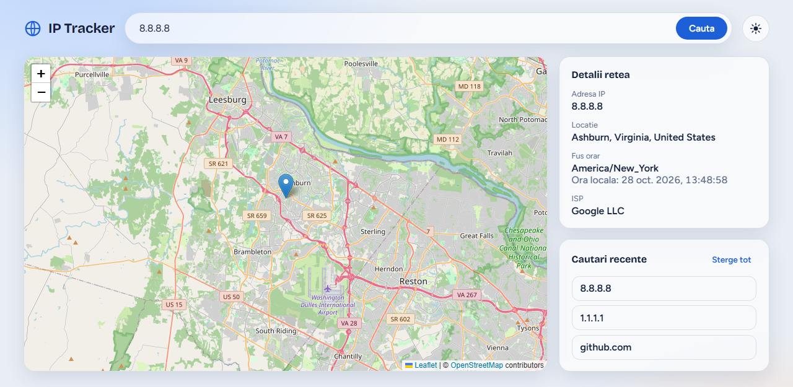

# IP Tracker

Aplicatie care arata informatii despre o adresa IP sau un domeniu: locatia aproximativa, fusul orar cu data si ora locala, furnizorul de internet (ISP) si pozitia pe harta. Exista in trei variante: pagina web din etapa 1 (HTML, CSS si JavaScript), aplicatia web in React si aplicatia mobila in React Native.



## Functionalitati

- Cautare dupa adresa IPv4, IPv6 sau domeniu; merge si un link intreg (`https://github.com/user` devine `github.com`)
- La pornire se afiseaza automat datele pentru IP-ul propriu
- Cardul cu rezultatul (adresa IP si locatia) si detaliile, fiecare cu iconita lui colorata: domeniul sau numele invers (hostname), ISP, locatia aproximativa, fusul orar, data si ora locala actualizate in fiecare secunda
- Harta cu locatia aproximativa a IP-ului: OpenStreetMap pe web, Google Maps (Android) sau Apple Maps (iOS) pe telefon
- Istoric cu ultimele 5 cautari, pastrat intre vizite; o cautare recenta se reface cu un click
- Tema luminoasa si intunecata, pastrata intre vizite
- Mesaje de eroare clare si blocuri de incarcare cat timp vin datele
- Design colorat si prietenos (teal si coral, carduri rotunjite cu umbra fina, fara gradient), adaptat pentru calculator, tableta si telefon

## Tehnologii

| | Etapa 1 (`vanilla/`) | Etapa 2: web (`web/`) | Etapa 2: mobil (`mobile/`) |
|---|---|---|---|
| Interfata | HTML, CSS, JavaScript | React 19 + Vite | React Native + Expo (SDK 58) |
| Harta | Leaflet | react-leaflet (Leaflet) | react-native-maps |
| Iconite | SVG scrise de mana | react-icons (Ionicons) | @expo/vector-icons (Ionicons) |
| Salvare locala | localStorage | localStorage | AsyncStorage |
| Teste | - | Vitest | - |

Datele vin de la [ip-api.com](https://ip-api.com/). Codul comun pentru web si mobil (validarea, cererea catre API, formatarea, istoricul si doua hook-uri React) este in `shared/` si este testat cu Vitest din `web/`.

## Rulare locala

Ai nevoie de Node.js (versiunea LTS) si, pentru aplicatia mobila, de aplicatia Expo Go pe telefon.

**Web (React):**

```bash
cd web
npm install
npm run dev
```

apoi deschide http://localhost:5173. Testele: `npm test`.

**Mobil (React Native):**

```bash
cd mobile
npm install
npx expo start
```

apoi scaneaza codul QR cu Expo Go (Android) sau cu camera (iPhone). Telefonul si calculatorul trebuie sa fie in aceeasi retea Wi-Fi; altfel foloseste `npx expo start --tunnel`.

**Etapa 1 (HTML, CSS, JavaScript):**

```bash
cd vanilla
python -m http.server 5500
```

apoi deschide http://localhost:5500 (sau foloseste Live Server din VS Code).

> Planul gratuit ip-api.com functioneaza doar prin HTTP si permite 45 de cereri pe minut. Pe o gazduire HTTPS (de exemplu GitHub Pages), browserul blocheaza cererile, iar aplicatia afiseaza un mesaj in acest sens.

## Structura proiectului

```text
IP_Tracker/
├── vanilla/     etapa 1: HTML, CSS si JavaScript, fara framework
├── shared/      cod comun pentru web si mobil: api.js, useGeoSearch.js, format.js, useClock.js, history.js
├── web/         aplicatia React (Vite): src/components, src/hooks, tests
├── mobile/      aplicatia React Native (Expo): App.js, src/components, src/hooks, theme.js
└── docs/        jurnalele echipei, ghidurile etapei 2 si captura de ecran
```

## Echipa

| Membru | GitHub | Etapa 1 | Etapa 2 | Jurnal |
|---|---|---|---|---|
| M | TudorMituleci | antetul si cautarea, temele, stilurile de baza, validarea si API-ul | scheletul web si mobil, designul (culori si tokeni), API-ul comun, hook-ul de cautare, antetul, cautarea si tema | [jurnal-M.md](docs/jurnal-M.md) |
| R | adevaratulrazvanlrs | grid-ul, cardul de detalii cu ora locala, animatiile de incarcare, harta | cardul cu rezultatul, detaliile cu ora locala si harta, pe web si pe mobil | [jurnal-R.md](docs/jurnal-R.md) |
| D | seba-dvd | istoricul, design-ul responsive, legarea modulelor, documentatia | istoricul, cardurile si asezarea in pagina, pe web si pe mobil, documentatia | [jurnal-D.md](docs/jurnal-D.md) |

In cod, comentariile de forma `R v2.2.0: ...` arata membrul care a scris blocul si versiunea in care a aparut. Explicatia completa se afla in jurnalul acelui membru, la versiunea respectiva. Ghidurile etapei 2 sunt in [docs/ghiduri](docs/ghiduri/README.md).

## Versiuni

| Versiune | Membru | Ce aduce |
|---|---|---|
| v1.0.0 | M | pagina de inceput: antetul, bara de cautare, tema light / dark, design de baza |
| v1.1.0 | M | primul API de geolocalizare (ipwho.is), butonul de tema functional |
| v1.2.0 | M | scheletul pentru R si D, tema prin theme.js, domenii prin ip-api.com, cache si validare stricta |
| v1.3.0 | R | grid-ul, cardul de detalii cu ora locala, animatiile de incarcare, harta cu marker si zoom animat |
| v1.4.0 | D | stilurile hartii, istoricul cautarilor, design-ul responsive, main.js final, documentatia |
| v2.0.0 | M | scheletul pentru React si React Native, codul comun din shared/, designul teal si coral |
| v2.1.0 | M | API-ul comun, hook-ul de cautare, antetul, bara de cautare si tema (web si mobil) |
| v2.2.0 | R | cardul cu rezultatul, detaliile cu ora locala si harta (web si mobil) |
| v2.3.0 | D | istoricul, cardurile si asezarea in pagina (web si mobil), README-ul etapei 2 |
