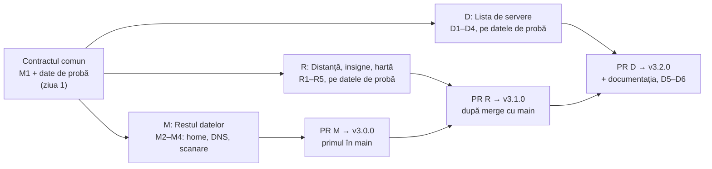

# IP Tracker – Propunere etapa 3

19 noiembrie 2026 · Pilat David (D)

Propunem nouă funcționalități noi, pe web și pe mobil, împărțite pe zonele de cod de acum: M pe date, R pe afișare și hartă, D pe liste, așezare și documentație. Recomandarea e să începem cu primele trei, care au deja planul detaliat pe membri: cam 2–3 zile de lucru de persoană. Celelalte șase au un plan general, iar pe cele alese le detaliem după decizie. Fiecare alege Da, Poate sau Nu pentru fiecare idee, în [tabelul de la final](#decizia-echipei).

Documentul are și o variantă online, unde se poate comenta și alege direct în tabel: [IP Tracker – Propunere etapa 3](https://claude.ai/artifact/QKCzPitwqkH78mF87eiuqX) (se deschide doar după ce David o partajează).

## Cele trei recomandate

Toate trei folosesc servicii gratuite, fără chei de API. Le-am verificat pe 19 noiembrie 2026 cu cereri reale.

| Funcționalitate | Ce vede utilizatorul | De unde vin datele | Efort |
| --- | --- | --- | --- |
| 1. Distanța până la IP | O linie curbă animată pe hartă, de la locația ta la cea căutată, și textul „1.847 km de tine” în card | Locația ta e deja primul rezultat de la pornire; distanța se calculează local (formula haversine) | mic |
| 2. Detectorul de conexiune | Steagul țării și insigne: „VPN / proxy”, „Server de datacenter”, „Rețea mobilă” | Câmpurile gratuite `countryCode`, `proxy`, `hosting`, `mobile` de la ip-api.com (pentru 8.8.8.8 întoarce `proxy: true`, `hosting: true`) | mic |
| 3. Radiografia domeniului | Butonul „Vezi toate serverele” la un domeniu: toate IP-urile lui pe hartă și o listă de tipul „9 servere în 3 țări” | Înregistrările DNS A, AAAA și MX prin `dns.google` (HTTPS, permis din browser), apoi o singură cerere `ip-api.com/batch` pentru toate IP-urile | mediu |

Structura de acum rămâne: căutarea, cardul, detaliile, harta și istoricul nu se schimbă, doar primesc informații în plus.

## Celelalte șase variante – planul general

Toate folosesc doar servicii gratuite, fără chei. Coloanele M, R și D spun ce ar face fiecare dacă alegem ideea. Planul pe sarcini, ca cel de mai jos, îl scriem după decizie.

| Idee | Ce vede utilizatorul | M (date) | R (afișare, hartă) | D (liste, așezare, documentație) | Efort | Depinde de |
| --- | --- | --- | --- | --- | --- | --- |
| 4. Tu vs IP-ul tău (doar pe mobil) | „IP-ul te plasează la 23 km de unde ești”: locația GPS reală lângă cea dedusă din IP | Instalează `expo-location`, scrie hook-ul care cere permisiunea și citește poziția | Al doilea marker și linia dintre ele | Textul explicativ în card, secțiunea din README | mediu | 1 (distanța și linia) |
| 5. Harta istoricului | Butonul „Arată tot”: toate căutările din istoric apar odată pe hartă | – | Markerii pentru istoric (refolosește markerii serverelor) | Istoricul păstrează și coordonatele și orașul, nu doar textul căutat; butonul | mediu | 3 (markerii multipli) |
| 6. Compararea a două IP-uri | Două carduri alăturate și distanța dintre ele | Al doilea rezultat în starea căutării (`useCompare`) | Linia și distanța între cele două puncte | Cele două carduri alăturate, pe desktop și pe telefon | mediu–greu | 1 |
| 7. Vremea la locația găsită | Temperatura și starea vremii lângă ora locală, de exemplu „13 °C, înnorat” | `shared/weather.js` cu Open-Meteo (HTTPS, permis din browser, verificat) | Codul vremii transformat în text și iconiță, rândul nou în detalii | Testele pentru codurile de vreme | mic | – |
| 8. Link de partajat | Web: adresa `?q=8.8.8.8` deschide direct căutarea. Mobil: butonul de partajare al telefonului. | Căutarea pornită din adresă la deschidere | – | Butonul de partajare și actualizarea adresei după fiecare căutare | mic | – |
| 9. Glob 3D (doar pe web) | Un glob care se rotește până la locație, în locul hărții plate | – | Componenta cu biblioteca globe.gl, cu comutare între hartă și glob | Comutatorul în pagină | greu | – |

Variantele cu efort mic (7 și 8) se pot adăuga oricând, chiar și după primele trei. Globul 3D adaugă o bibliotecă grea și nu are echivalent pe mobil, deci îl lăsăm ultimul.

## Contractul nou din shared/

M fixează formele de mai jos în primul commit. R și D lucrează doar pe ele, deci pot începe în paralel, cu date de probă, înainte ca M să termine.

**Rezultatul unei căutări** (`fetchGeoData`) primește patru câmpuri noi, iar cele vechi rămân la fel:

```js
{
  ip, host, isp, city, region, country, timezone, latitude, longitude, // ca acum
  countryCode: 'US',   // cod ISO din două litere, '' dacă lipsește
  proxy: false,        // VPN, proxy sau Tor
  hosting: true,       // server de datacenter
  mobile: false,       // rețea de telefonie mobilă
}
```

**Locația proprie:** `useGeoSearch` întoarce și `home`, adică primul rezultat de la pornire (IP-ul utilizatorului). Pe el se calculează distanța.

**Un server al unui domeniu** (`useDomainScan`, funcționalitatea 3) are forma rezultatului de mai sus plus:

```js
{ ...rezultat, record: 'A' }   // 'A' (IPv4), 'AAAA' (IPv6) sau 'MX' (server de e-mail)
```

## Mituleci Tudor (M) – datele și API-ul, v3.0.0

M lucrează doar în `shared/`, deci același cod merge pe web și pe mobil. Primul lui commit e contractul de mai sus, ca R și D să nu-l aștepte.

| Sarcină | Ce face | Fișiere | Dificultate |
| --- | --- | --- | --- |
| M1 | Adaugă `countryCode`, `proxy`, `hosting`, `mobile` în `FIELDS` și în rezultat, cu valori implicite când lipsesc | `shared/api.js`, `web/tests/api.test.js` | ușor |
| M2 | Pune `home` în `useGeoSearch`: primul rezultat reușit, care nu se mai schimbă la căutările următoare | `shared/useGeoSearch.js` | ușor |
| M3 | `resolveDomain(domeniu)`: citește A, AAAA și MX de la `dns.google`, transformă serverele MX în IP-uri, scoate dublurile, păstrează maximum 20. Apoi `fetchGeoBatch(ip-uri)` cu o singură cerere `POST ip-api.com/batch`. Erorile au mesaj în română, ca acum. | `shared/dns.js` (nou), `web/tests/dns.test.js` (nou, cu `fetch` simulat) | mediu |
| M4 | Hook-ul `useDomainScan`: `servers`, `loading`, `error`, `scan(domeniu)`, `clear()`. Ignoră răspunsurile vechi, la fel ca `useGeoSearch`. | `shared/useDomainScan.js` (nou) | mediu |
| M5 | Date de probă pentru R și D (un rezultat cu insigne, un domeniu cu 5 servere), pull request, tag-ul v3.0.0 și jurnalul | `shared/demo-data.js` (nou), `docs/jurnal-M.md` | ușor |

**Gata când:** `npm test` trece în `web/`, cu teste noi pentru M1 și M3, iar `fetchGeoData('8.8.8.8')` întoarce `proxy` și `hosting` pe `true`.

## Luncașu Răzvan (R) – distanța, insignele și harta, v3.1.0

R lucrează pe aceleași componente ca în v2.2.0: cardul cu rezultatul și harta. Pe hartă desenează și serverele domeniului, iar lista lor o face D.

| Sarcină | Ce face | Fișiere | Dificultate |
| --- | --- | --- | --- |
| R1 | Funcții noi, cu teste: `distanceKm(a, b)` (haversine), `formatDistance` („1.847 km de tine”, „sub 1 km”), `countryFlag('RO')` (steagul ca emoji), `connectionBadges(rezultat)` (lista de insigne cu iconiță și ton), `arcPoints(a, b)` (punctele liniei curbe) | `shared/format.js`, `web/tests/format.test.js` | mediu |
| R2 | Web: steagul lângă țară, insignele și distanța în card. Distanța nu apare când rezultatul e chiar IP-ul tău. | `web/src/components/ResultSummary.jsx` (+ `.css`) | ușor |
| R3 | Web: un marker pentru locația ta, linia curbă animată până la rezultat, cu harta încadrată pe amândouă. Cu `servers`, câte un marker pe server, cu fereastră la apăsare. | `web/src/components/MapPanel.jsx` (+ `.css`) | greu |
| R4 | Mobil: același card ca la R2 | `mobile/src/components/ResultSummary.js` | ușor |
| R5 | Mobil: harta ca la R3, cu `Polyline` (opțiunea `geodesic` face curba) și `fitToCoordinates`. Linia poate fi statică, animația pe mobil e opțională. | `mobile/src/components/MapPanel.js` | mediu |
| R6 | Pull request, tag-ul v3.1.0 și jurnalul | `docs/jurnal-R.md` | ușor |

**Gata când:** testele noi din `format.test.js` trec, iar căutarea `8.8.8.8` arată pe ambele platforme steagul SUA, insignele „VPN / proxy” și „Server de datacenter”, plus linia de la locația ta.

## Pilat David (D) – lista de servere, legarea și documentația, v3.2.0

D face partea vizibilă a radiografiei (lista de servere) și leagă totul în `App`, ca în v2.3.0. `App.jsx` e structura lui M, așa că D îl modifică doar cu acordul lui, sau M lasă în schelet locul pentru card.

| Sarcină | Ce face | Fișiere | Dificultate |
| --- | --- | --- | --- |
| D1 | `summarizeServers(servere)`: numără serverele și țările și scrie textul cu pluralul corect („1 server”, „2 servere în 2 țări”, „20 de servere”), cu teste | `shared/servers.js` (nou), `web/tests/servers.test.js` (nou) | ușor |
| D2 | Web: butonul „Vezi toate serverele”, apărut doar când s-a căutat un domeniu, și cardul cu lista: steag, IP, tipul (A, AAAA, MX), oraș. Un clic pe server îl arată pe hartă. | `web/src/components/ServerList.jsx` (nou, + `.css`) | mediu |
| D3 | Web: leagă `useDomainScan` în `App`, trimite `servers` la hartă și așază cardul nou pe desktop, tabletă și telefon | `web/src/App.jsx`, `web/src/App.css` | mediu |
| D4 | Mobil: același buton și aceeași listă, legate în `App.js`, în `Panel` | `mobile/src/components/ServerList.js` (nou), `mobile/App.js` | mediu |
| D5 | Documentația: secțiunea etapei 3 din README cu o captură nouă, `arhitectura.md`, `plan-proiect.md` și charter-ul. Verificarea finală pe `main`, pe web și pe telefon. | `README.md`, `docs/` | mediu |
| D6 | Pull request, tag-ul v3.2.0 și jurnalul | `docs/jurnal-D.md` | ușor |

**Gata când:** căutarea `netflix.com`, urmată de „Vezi toate serverele”, arată lista și markerii pe web și în Expo Go, iar pagina nu se strică pe un ecran de telefon.

## Ordinea de lucru



M pune contractul și datele de probă în prima zi. Apoi toți trei lucrează în paralel, iar pull request-urile se unesc în ordinea M, R, D, ca în etapele trecute. Fiecare face `git merge origin/main` înainte de pull request-ul lui.

## Riscuri și limite

| Risc | Ce facem |
| --- | --- |
| ip-api.com permite 45 de căutări pe minut și 15 cereri batch pe minut | Cache-ul de acum rămâne. O radiografie e o singură cerere batch, iar dacă trecem de limită apare mesajul existent „Prea multe cereri”. |
| ip-api.com merge doar prin HTTP, deci aplicația web tot nu poate fi publicată online | Ca până acum, o prezentăm local. `dns.google` e pe HTTPS, deci nu adaugă o problemă nouă. |
| Detectarea VPN se bazează pe liste și poate greși (pentru 8.8.8.8 spune și „proxy”) | Textul insignei e „Posibil VPN / proxy”, nu o afirmație sigură. |
| „Locația ta” e tot locația IP-ului tău, nu GPS-ul | Distanța e aproximativă, la fel ca restul aplicației, și scriem asta în README. |
| Unele domenii au un singur IP (github.com, wikipedia.org) | La demo folosim domenii cu mai multe servere, de exemplu netflix.com sau google.com. |
| Nu ajunge timpul pentru toate trei | Funcționalitățile 1 și 2 nu depind de 3. Dacă renunțăm la radiografie, rămân M1–M2, R1–R4 (fără markerii serverelor) și D5–D6. |
| Conflicte la unirea branch-urilor în `App` și în `MapPanel` | Unim în ordinea M, R, D, ca în etapele trecute, și fiecare face `git merge origin/main` înainte de pull request. |

## Demo la prezentare

Cele trei funcționalități recomandate se arată live în cam două minute, întâi pe web, apoi pe telefon:

1. La pornire, harta arată locația IP-ului vostru.
2. Căutați `8.8.8.8`. Linia curbă pleacă de la voi până în SUA, cardul arată distanța, steagul și insignele „Posibil VPN / proxy” și „Server de datacenter”.
3. Porniți un VPN gratuit pe laptop și reîncărcați pagina. Propriul IP apare acum în altă țară, cu insigna de VPN.
4. Căutați `netflix.com` și apăsați „Vezi toate serverele”. Pe hartă apar toți markerii, iar un clic pe un server din listă îl arată pe hartă.
5. Repetați pașii 2 și 4 în Expo Go, pe telefon.

## Decizia echipei

Fiecare scrie în coloana lui Da, Poate sau Nu, pentru fiecare idee (aici, într-un commit pe branch-ul lui, sau direct în varianta online). Facem o idee dacă au ales-o toți trei, iar pentru cele alese scriem planul pe sarcini, ca la primele trei.

| Idee | Mituleci Tudor (M) | Luncașu Răzvan (R) | Pilat David (D) | Observații |
| --- | --- | --- | --- | --- |
| 1. Distanța până la IP | | | | |
| 2. Detectorul de conexiune | | | | |
| 3. Radiografia domeniului | | | | |
| 4. Tu vs IP-ul tău | | | | |
| 5. Harta istoricului | | | | |
| 6. Compararea a două IP-uri | | | | |
| 7. Vremea la locație | | | | |
| 8. Link de partajat | | | | |
| 9. Glob 3D | | | | |
